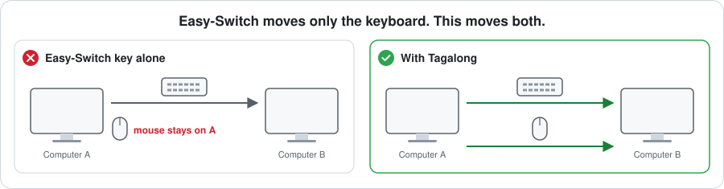
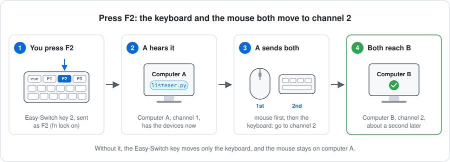
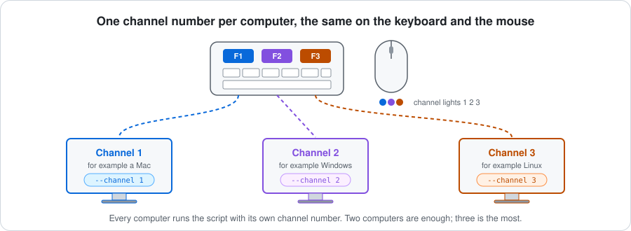
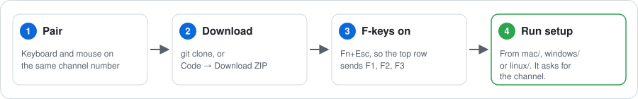

<p align="center">
  <picture>
    <source media="(prefers-color-scheme: dark)" srcset="docs/logo-dark.svg">
    
  </picture>
</p>

<p align="center"><b>Your mouse tags along when your Logitech keyboard switches computers.</b></p>

<p align="center">
  <a href="https://github.com/jenkasia/tagalong/actions/workflows/ci.yml"></a>
  <a href="https://github.com/jenkasia/tagalong/actions/workflows/codeql.yml"></a>
  <a href=".github/dependabot.yml"></a>
  <a href="LICENSE"></a>
  <br>
  <a href="https://www.python.org/"></a>
  
  <a href="switch/requirements.txt"></a>
  <a href="https://github.com/jenkasia/tagalong/commits/main"></a>
  <a href="https://github.com/jenkasia/tagalong/stargazers"></a>
</p>



A small background script on each computer. No extra hardware, no cloud, no Logi Options+ Flow.

## Why



## How it works



- Press **F1 / F2 / F3** to go to channel **1 / 2 / 3**.
- The computer that has the devices sends them both there.

## What you need

- Logitech keyboard and mouse with **Easy-Switch**, connected over **Bluetooth** ([which devices](docs/LOGITECH.md#which-devices-work))
- Each computer on the **same channel number** on both devices



## Setup

Do this on **every** computer:



```bash
git clone https://github.com/jenkasia/tagalong.git
```

Or **Code → Download ZIP**. Then run the setup for your system:

| System | Setup | Guide |
|---|---|---|
| macOS | `mac/setup.sh` | [mac/](mac/README.md) |
| Windows | double-click `windows\setup.bat` | [windows/](windows/README.md) |
| Linux (untested) | `linux/setup.sh` | [linux/](linux/README.md) |

## Use

| Press | Result |
|---|---|
| F1 / F2 / F3 | Keyboard **and** mouse go to channel 1 / 2 / 3 |
| Fn+F1 / F2 / F3 | Keyboard only (Logitech's own Easy-Switch) |

## More

- [Logitech Easy-Switch, pairing and supported devices](docs/LOGITECH.md)
- [Troubleshooting](docs/TROUBLESHOOTING.md)
- [How it works inside](docs/TECHNICAL.md)

## License

[MIT](LICENSE). Not affiliated with or endorsed by Logitech.
