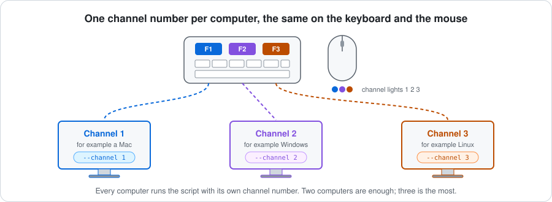

# Logitech Easy-Switch, devices and pairing

[← Back to the README](../README.md)

## Easy-Switch in short



- Many Logitech keyboards and mice remember up to **3 computers**, one per **channel** (1, 2, 3).
- **Keyboard:** three Easy-Switch keys, often on F1–F3, with a light for the active channel.
- **Mouse:** one Easy-Switch button underneath, with three lights.
- Each device switches **on its own**. That's the gap this tool fills.

## Pair a device on a channel

The usual way for MX devices (check your manual if yours differs):

| Device | Steps |
|---|---|
| Keyboard | Hold the channel's Easy-Switch key for 3 s, until its light blinks fast. Then pair it in the computer's Bluetooth settings. |
| Mouse | Press the button underneath until the channel's light is on. Hold it for 3 s, until it blinks fast. Then pair it in Bluetooth settings. |

Use the **same channel number** for the keyboard and the mouse on each computer.
Pairing a channel again replaces what was there before.

## Which devices work

The device needs **Bluetooth** and the HID++ `CHANGE_HOST` feature, which is the feature behind Easy-Switch.

| Status | Devices |
|---|---|
| ✅ Tested | MX Keys Mini (Mac version), MX Master 3 |
| 🟡 Likely, untested | MX Keys, MX Keys S, MX Mechanical, MX Master 3S, MX Anywhere 3, K380, K780, Pebble series and other Easy-Switch devices |
| ❌ Not yet | Anything on a Bolt or Unifying USB receiver |

To know for sure, run the check: it prints "can switch" for each device that works.

```bash
.venv/bin/python switch/check.py          # macOS / Linux
.venv\Scripts\python switch\check.py      # Windows
```

Tried another device? An issue or pull request adding it here is welcome.

## Logi Options+

- You don't need it, and it can stay installed.
- If Options+ gives F1–F3 a custom action, the script may not get them: set them back to the default.
- Options+ **Flow** is similar (the mouse crosses screen edges), but it needs Options+ on every computer
  and all of them on one network. This tool needs neither.
