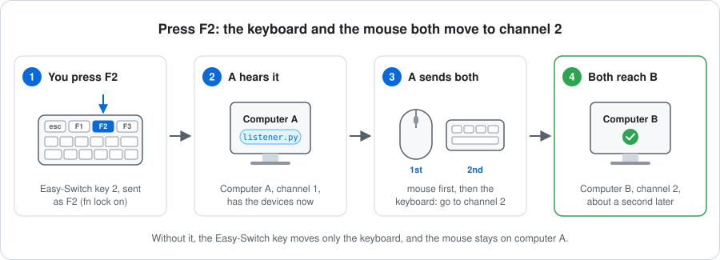

# How it works inside

[← Back to the README](../README.md)

## HID++

Logitech devices speak **HID++ 2.0**, a vendor protocol inside ordinary HID reports. Over Bluetooth LE it
uses a vendor HID collection (usage page `0xFF43`, usage `0x0202`) with 20-byte long reports
(report ID `0x11`, device index `0xFF`).

| Feature | ID | Used for |
|---|---|---|
| Root | `0x0000` | Finding each feature's index |
| Device name | `0x0005` | The device name in `check.py` |
| Change host | `0x1814` | Reading the channel, and **sending the device to another channel** |
| Reprogrammable controls v4 | `0x1B04` | Easy-Switch key flags (`check.py --verbose`, `dev/`) |
| Fn inversion | `0x40A3` | Warning when the top row isn't sending F-keys |

A device that gets `CHANGE_HOST` leaves at once without replying, so the mouse goes first, then the keyboard.

## How each system sees the key

| System | How |
|---|---|
| macOS | Reads the keyboard's own input reports through hidapi, opened in shared mode. Needs Input Monitoring. |
| Linux | The same, through hidraw. Needs read/write access to `/dev/hidraw*` (the udev rule). |
| Windows | Windows keeps keyboard reports to itself, so it uses global hotkeys (`RegisterHotKey`). |

## Why not watch the Easy-Switch key itself?

On the keyboards tested, the Easy-Switch keys can't be handed to software, and pressing one tells the computer
nothing before the keyboard leaves. So the tool uses the F-key layer instead. `dev/guided_test.py` shows this
for your own keyboard.

## Files

| Path | What it is |
|---|---|
| `switch/listener.py` | The switch |
| `switch/hidpp.py` | A small HID++ 2.0 client (Bluetooth) |
| `switch/check.py` | Lists your devices and their channels |
| `mac/setup.sh` | Installs it on macOS as a LaunchAgent |
| `windows/setup.bat`, `windows/setup.ps1` | Installs it on Windows in the Startup folder |
| `linux/setup.sh` | Installs it on Linux as a systemd user service, plus a udev rule |
| `dev/` | Research scripts |

[Solaar](https://github.com/pwr-Solaar/Solaar), a Linux manager for Logitech devices, is a good HID++ reference.
